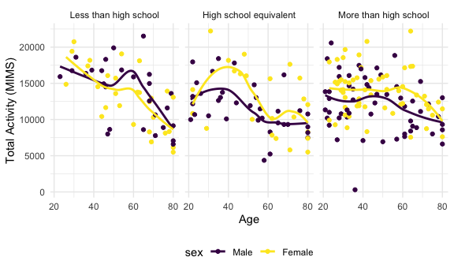
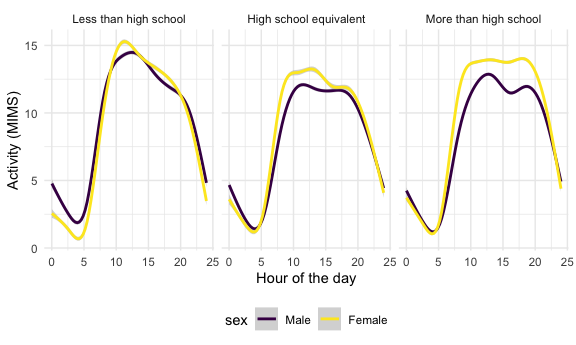
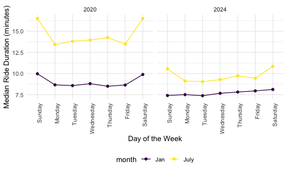
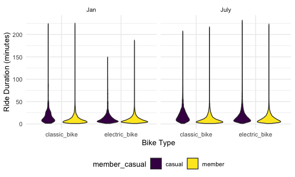
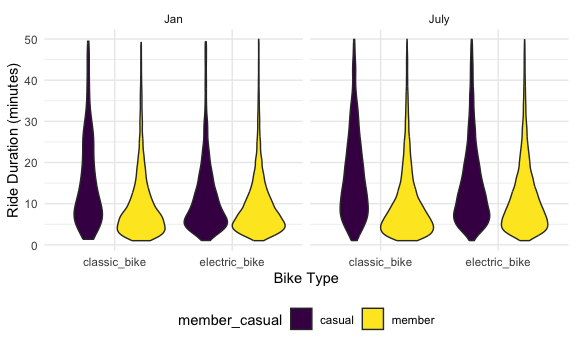

Homework 3
================
2026-10-12

# Problem 1

``` r
library(p8105.datasets)
data("ny_noaa")

ny_noaa = ny_noaa |> 
  separate(date, into = c("year", "month"), 4) |> 
  separate(month, into= c("month", "day"), 3) |> 
  mutate(
    year = as.numeric(year),
    month = as.numeric(month)*-1,
    day = as.numeric(day)*-1,
    tmax = as.numeric(tmax),
    tmin = as.numeric(tmin)
  )

#According to the codebook, precipitation is reported in tenths of mm, so we need to divide by 10; tmax and tmin are also in tenths of degrees C

ny_noaa = 
  ny_noaa |> 
  mutate(
    prcp = prcp/10,
    tmax = tmax/10,
    tmin = tmin/10
  )
```

The `ny_noaa` dataset contains daily weather data for New York from 1981
to 2010. The variables include the date, maximum and minimum
temperatures, precipitation, and snowfall (depth and amount). There are
2,595,176 observations in this dataset. The average values for each
variable are as follows:

- the average maximum temperature is 14 degrees Celsius

- the average minimum temperature is 3 degrees Celsius

- the average precipitation is 3 mm

- the average snowfall is 5 mm

- the average snowfall depth is 37.3 mm

There is quite a bit of missing data in this dataset. There are,

- 1,134,358 missing values for maximum temperature (43.71 % of the data)

- 1,134,420 missing values for minimum temperature (43.71 % of the data)

- 145,838 missing values for precipitation (5.62 % of the data)

- 381,221 missing values for snowfall (14.69 % of the data)

- 591,786 missing values for snowfall depth (22.8 % of the data)

Thus, missing data is clearly an issue in this dataset.

``` r
ny_noaa |>
  group_by(snow) |>
  summarize(
    count=n()
  ) |>
  arrange(desc(count)) |> 
  head(5)
```

    ## # A tibble: 5 × 2
    ##    snow   count
    ##   <int>   <int>
    ## 1     0 2008508
    ## 2    NA  381221
    ## 3    25   31022
    ## 4    13   23095
    ## 5    51   18274

The most commonly observed values are close to 0 for snowfall.
Specifically, the most common values (aside from NA) are 0, 25, and 13
mm. This is because this weather data is taken for every day of the
year, and in NY, there is only snow a couple months of the year, and
there only tends to be a couple of days of heavy snowfall a year. 25mm
is approximately 1 inch, and 13mm is approximately 0.5 inches, which are
both reasonable amounts of snowfall for a single day in NY.
Additionally, measurements are often captured in inches and then
converted to mm, which could explain why 1 and 0.5 inches are the most
common values aside from 0.

``` r
ny_noaa |> 
  filter(month %in% c(1, 7)) |> 
  mutate(
    month = case_match(
      month,
      1 ~ "January",
      7 ~ "July"
    )
  ) |> 
  group_by(id, year, month) |> 
  summarize(avg_tmax = mean(tmax, na.rm = TRUE)) |> 
  ggplot(aes(x = year, y = avg_tmax, group = id)) + 
  geom_line() + 
  geom_smooth(aes(group = NULL))+ #removing grouping so there is one overall smooth line rather than a line for each station
  facet_grid(.~month) + 
  labs(
    x = "Year",
    y = "Average Max Temperature (C)"
  )
```

    ## Warning: There was 1 warning in `mutate()`.
    ## ℹ In argument: `month = case_match(month, 1 ~ "January", 7 ~ "July")`.
    ## Caused by warning:
    ## ! `case_match()` was deprecated in dplyr 1.2.0.
    ## ℹ Please use `recode_values()` instead.

    ## Warning: Removed 5970 rows containing non-finite outside the scale range
    ## (`stat_smooth()`).

    ## Warning: Removed 5932 rows containing missing values or values outside the scale range
    ## (`geom_line()`).


The values appear to be much lower in January than July. They also tend
to be more variable in January. There appears to be one outlier in July
around 14 degrees C in 1988 (with a couple other points being potential
outliers). It is hard to tell if any of the January values would be
considered outliers without conducting further analyses. The graphs show
a cyclical pattern rather than a long-term change over time, consistent
with what we would expect for weather from year to year.

``` r
p1_i_plot = ny_noaa |> 
  ggplot(aes(x = tmin, y = tmax)) + 
  geom_hex() + 
  labs(
    x = "Minimum Temperature (C)",
    y = "Maximum Temperature (C)"
  ) +
  theme(legend.text = element_text(angle = 45, hjust = 1))

p1_ii_plot = ny_noaa |> 
  filter(snow > 0, snow < 100) |> 
  ggplot(aes(x = snow, y = factor(year))) + 
  geom_density_ridges() + 
  labs(x = "Snowfall (mm)", y = "Year") +
  theme(axis.text.y = element_text(size=6))

p1_i_plot + p1_ii_plot
```

    ## Warning: Removed 1136276 rows containing non-finite outside the scale range
    ## (`stat_binhex()`).


According to the hex plot, there appears to be a strong linear trend
between maximum and minimum temperatures. There appears to be a few
stations for which tmax is reported as lower than tmin, indicating
errors in the data. There are also some extreme values (i.e. 60 degrees
C) that are not plausible for NY.

Additionally, each year shows higher counts of lower snowfall amounts.
In most years, there appear to be a couple days with bigger snowfalls
(around 80mm), which are likely from the 1-2 storms we have each year.
Otherwise, most snowfall clusters between 0-40mm.

# Problem 2

``` r
# for nhanes_demog, 1 = male, 2 = female, 1 = Less than high school, 2 =  High school equivalent, 3  = More than high school

nhanes_demog = read_csv("data/nhanes_covar.csv", skip = 4) |> 
  janitor::clean_names() |> 
  mutate(
    sex = case_match(
      sex,
      1 ~ "Male",
      2 ~ "Female"
    ),
    education = case_match(
      education,
      1 ~ "Less than high school",
      2 ~ "High school equivalent",
      3 ~ "More than high school"
      )
    ) |> 
  mutate(
    education = fct_relevel(education, c("Less than high school", "High school equivalent", "More than high school")),
    sex = fct_relevel(sex, c("Male", "Female"))
  ) |> 
  filter(age >= 21) |> 
  drop_na()

nhanes_accel = read_csv("data/nhanes_accel.csv") |> 
  janitor::clean_names() |> 
  pivot_longer(
    starts_with("min"),
    names_to = "minute",
    names_prefix = "min",
    values_to = "mims"
  ) |> 
  mutate(
    minute = as.numeric(minute)
  )

nhanes = left_join(nhanes_demog, nhanes_accel, by = "seqn")
```

``` r
nhanes_demog |> 
  count(education, sex) |> 
  pivot_wider(names_from = sex, values_from = n) |> 
  knitr::kable()
```

| education              | Male | Female |
|:-----------------------|-----:|-------:|
| Less than high school  |   27 |     28 |
| High school equivalent |   35 |     23 |
| More than high school  |   56 |     59 |

Out of the three levels of education, “More than high school” has the
highest number of males and females. There are more females in the “Less
than high school” category than the “High echool equivalent” category.
There are more males with “High school equivalent” than females, but in
the other categories the numbers are pretty similar. There are more
males than females in the sample.

``` r
nhanes |> 
  ggplot(aes(x=sex, y = age))+
  geom_boxplot()+
  facet_grid(.~education) + 
  labs(
    x = "Sex",
    y = "Age"
  )
```


The distributions of all of the groups overlap substantially. In
general, people with more than high school educations are a bit younger,
though the quantiles overlap substantially.

``` r
nhanes |> 
  group_by(seqn, sex, education, age) |> 
  summarize(total_mims = sum(mims), .groups = "drop") |> 
  ggplot(aes(x = age, y = total_mims, color = sex))+
  geom_point()+
  geom_smooth(se = FALSE)+
  facet_grid(.~education)+
  labs(
    x = "Age",
    y = "Total Activity (MIMS)"
  )
```



Total activity declines with age in all three education groups, most
steeply among those with less than a high school education. Women
generally have higher total activity than men in the “High school
equivalent” and “More than high school” groups, while in “Less than high
school” the pattern is mixed, with men slightly higher around ages
50–60.

``` r
nhanes |> 
  ggplot(aes(x = minute/60, y = mims, color = sex)) + 
  geom_smooth() + 
  facet_grid(.~education) +
  labs(x = "Hour of the day", y = "Activity (MIMS)")
```



In all three graphs, activity happens in the middle of the day. Females
have slightly higher activity than males. There does not appear to be
any major differences activity across education groups, aside from
slightly higher activity levels in people with less than a high school
education. Where “High school equivalent” and “More than high school”
tend to plateau through the day (approximately 10am to 8pm), “less than
high school” has more of a point around 12pm.

# Problem 3

``` r
citibike_0120 = read_csv("data/citibike/Jan 2020 Citi.csv") |> 
  mutate(month = "Jan",
         year = "2020")
citibike_0720 = read_csv("data/citibike/July 2020 Citi.csv")|> 
  mutate(month = "July",
         year = "2020")
citibike_0124 = read_csv("data/citibike/Jan 2024 Citi.csv")|> 
  mutate(month = "Jan",
         year = "2024")
citibike_0724 = read_csv("data/citibike/July 2024 Citi.csv")|> 
  mutate(month = "July",
         year = "2024")

citibike = bind_rows(citibike_0120, citibike_0720, citibike_0124, citibike_0724) |> 
  janitor::clean_names() |> 
  mutate(
    month = fct_relevel(month, c("Jan", "July")),
    year = fct_relevel(year, c("2020", "2024")),
    rideable_type = fct_relevel(rideable_type, c("classic_bike", "electric_bike")),
    weekdays = fct_relevel(weekdays, c("Sunday", "Monday", "Tuesday", "Wednesday", "Thursday", "Friday", "Saturday"))
  )
```

The `citibike` dataset has 99,485 observations and 9 variables. The
variables include the ride ID, start and end times, bike type, duration,
start and end station names and IDs, rider type (member or casual),
year, month, and day of the week.

There are:

- 55,536 rides on classic bikes and 43,949 rides on electric bikes in
  the dataset.

- 79,862 rides by members and 19,623 rides by casual riders in the
  dataset

- 12,420 rides from January 2020, 21,048 rides from July 2020, 18,861
  rides from January 2024, and 47,156 rides from July 2024.

- the average duration of rides is 13.93 minutes.

``` r
citibike |> 
  group_by(year, month, member_casual) |> 
  summarize(
    total_rides = n()
  ) |> 
  pivot_wider(
    names_from = member_casual,
    values_from = total_rides
  ) |>
  knitr::kable(digits=2)
```

| year | month | casual | member |
|:-----|:------|-------:|-------:|
| 2020 | Jan   |    984 |  11436 |
| 2020 | July  |   5637 |  15411 |
| 2024 | Jan   |   2108 |  16753 |
| 2024 | July  |  10894 |  36262 |

From this table, it is evident that both members and casual riders tend
to ride more in July than January. Additionally, across both casual
riders and members, rides increased between 2020 and 2024. Overall,
there are more rides by members than casual riders across all groups.

``` r
citibike |> 
  filter(year == "2024", month == "July") |> 
  group_by(start_station_name) |> 
  summarize(
    total_rides = n()
  ) |> 
  arrange(desc(total_rides)) |>
  head(n=5) |> 
  knitr::kable(digits=2)
```

| start_station_name       | total_rides |
|:-------------------------|------------:|
| Pier 61 at Chelsea Piers |         163 |
| University Pl & E 14 St  |         155 |
| W 21 St & 6 Ave          |         152 |
| West St & Chambers St    |         150 |
| W 31 St & 7 Ave          |         146 |

``` r
citibike |> 
  group_by(year, month, weekdays) |> 
  summarize(
    median_ride_duration = median(duration, na.rm = TRUE)
  ) |> 
  ggplot(aes(x = weekdays, y = median_ride_duration, color = month, group = month)) + 
  geom_point() + 
  geom_line() + 
  facet_grid(.~year) + 
  theme(axis.text.x = element_text(angle = 90, hjust = 1)) +
  labs(
    x = "Day of the Week",
    y = "Median Ride Duration (minutes)"
  )
```



From these plots, it is evident that the median ride duration is longer
in July than January in both 2020 and 2024. Additionally, the median
ride duration is longer in 2020 than 2024. In July of both years, the
median ride duration tends to be longest on weekends and shortest on
weekdays. In January, though, in 2020 the median ride duration is higher
on weekends, but in 2024, it is relatively constant, with the longest
median ride duration of Thursday-Saturday.

``` r
citibike |> 
  filter(year == "2024") |> 
  ggplot(aes(x = rideable_type , y = duration, fill = member_casual)) + 
  geom_violin() + 
  facet_grid(.~month) + 
  labs(
    x = "Bike Type",
    y = "Ride Duration (minutes)"
  )
```



Ride durations are strongly right-skewed across all combinations of
month, bike type, and membership status: most rides peak around 5–10
minutes and nearly all are under 50 minutes, but there are outliers that
stretch the violins out. Thus, for better visualization, I will do
another plot restricted to rides less than 50 minutes of ride duration.

``` r
citibike |> 
  filter(year == "2024", duration <=50) |> 
  ggplot(aes(x = rideable_type , y = duration, fill = member_casual)) + 
  geom_violin() + 
  facet_grid(.~month) + 
  labs(
    x = "Bike Type",
    y = "Ride Duration (minutes)"
  )
```



Restricting to rides of 50 minutes or less (which excludes 2% of 2024
rides), ride durations are right-skewed in every group, with most rides
lasting under 15 minutes. Membership status shows the clearest
difference: members’ rides are concentrated around 4–5 minutes, while
casual riders’ rides peak slightly later and are spread more widely
across 10–30 minutes. This difference is largest for classic bikes. For
members, the distributions look similar for classic and electric bikes,
whereas casual riders take somewhat longer rides on classic bikes than
on electric bikes. July rides are slightly longer and more spread out
than January rides, particularly among casual riders.
