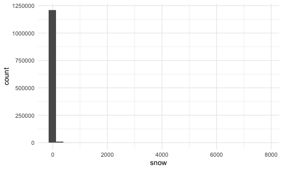
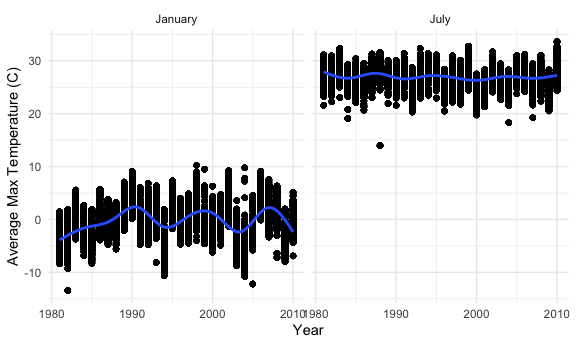
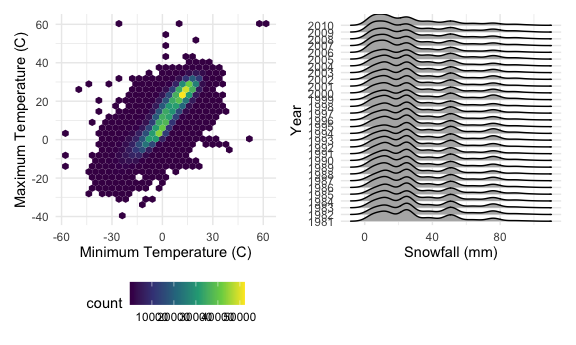
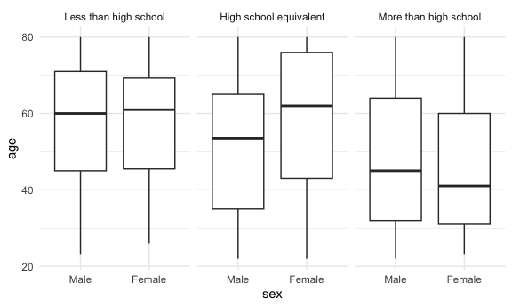
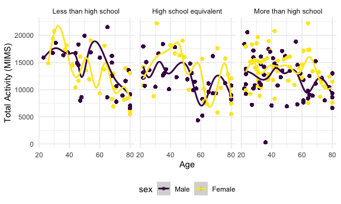
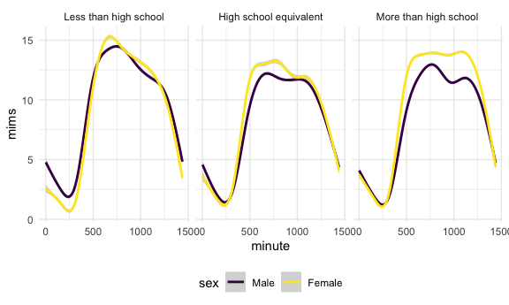

Homework 3
================
2026-10-12

# Problem 1

``` r
library(p8105.datasets)
data("ny_noaa")

ny_noaa = ny_noaa |> 
  separate(date, into = c("year", "month"), 4) |> 
  separate(month, into= c("month", "day"), 3) |> 
  mutate(
    year = as.numeric(year),
    month = as.numeric(month)*-1,
    day = as.numeric(day)*-1,
    tmax = as.numeric(tmax),
    tmin = as.numeric(tmin)
  )

#According to the codebook, precipitation is reported in tenths of mm, so we need to divide by 10; tmax and tmin are also in tenths of degrees C

ny_noaa = 
  ny_noaa |> 
  mutate(
    prcp = prcp/10,
    tmax = tmax/10,
    tmin = tmin/10
  )
```

This dataset contains daily weather data for New York from 1981 to 2010.
The variables include the date, maximum and minimum temperatures,
precipitation, and snowfall. There are 2595176 observations in this
dataset. The average values for each variable are as follows: - the
average maximum temperature is 14 degrees Celsius - the average minimum
temperature is 3 degrees Celsius - the average precipitation is 3 mm -
the average snowfall is 5 mm - the average snowfall depth is 37.3 mm

There is quite a bit of missing data in this dataset. There are, -
1134358 missing values for maximum temperature (43.7102532 % of the
data) - 1134420 missing values for minimum temperature (43.7126422 % of
the data) - 145838 missing values for precipitation (5.6195803 % of the
data) - 381221 missing values for snowfall (14.689601 % of the data)

``` r
ny_noaa |> 
  drop_na() |> 
  ggplot(aes(x = snow)) + 
  geom_histogram()
```

    ## `stat_bin()` using `bins = 30`. Pick better value `binwidth`.



``` r
ny_noaa |>
  count(snow) |>
  arrange(desc(n))
```

    ## # A tibble: 282 × 2
    ##     snow       n
    ##    <int>   <int>
    ##  1     0 2008508
    ##  2    NA  381221
    ##  3    25   31022
    ##  4    13   23095
    ##  5    51   18274
    ##  6    76   10173
    ##  7     8    9962
    ##  8     5    9748
    ##  9    38    9197
    ## 10     3    8790
    ## # ℹ 272 more rows

The most commonly observed values are close to 0 for snowfall.
Specifically, the most common values (aside from NA) are 0, 25, and 13
mm. This is because this weather data is taken for every day of the
year, and in NY, there is only snow a couple months of the year, and
there only tends to be a couple of days of heavy snowfall a year.

``` r
ny_noaa |> 
  filter(month %in% c(1, 7)) |> 
  mutate(
    month = case_match(
      month,
      1 ~ "January",
      7 ~ "July"
    )
  ) |> 
  group_by(id, year, month) |> 
  mutate(avg_tmax = mean(tmax, na.rm = TRUE)) |> 
  ggplot(aes(x = year, y = avg_tmax)) + 
  geom_point() + 
  geom_smooth()+
  facet_grid(.~month) + 
  labs(
    x = "Year",
    y = "Average Max Temperature (C)"
  )
```

    ## Warning: There was 1 warning in `mutate()`.
    ## ℹ In argument: `month = case_match(month, 1 ~ "January", 7 ~ "July")`.
    ## Caused by warning:
    ## ! `case_match()` was deprecated in dplyr 1.2.0.
    ## ℹ Please use `recode_values()` instead.

    ## `geom_smooth()` using method = 'gam' and formula = 'y ~ s(x, bs = "cs")'

    ## Warning: Removed 185070 rows containing non-finite outside the scale range
    ## (`stat_smooth()`).

    ## Warning: Removed 185070 rows containing missing values or values outside the scale range
    ## (`geom_point()`).


The values appear to be much lower in January than July. They also tend
to be more variable in January. There appears to be one outlier in July
(with a couple other points being potential outliers). It is hard to
tell if any of the January values would be considered outliers without
conducting further analyses. The graphs show a cyclical pattern rather
than a long-term change over time, consistent with what we would expect
for weather from year to year.

Make a two-panel plot showing (i) tmax vs tmin for the full dataset
(note that a scatterplot may not be the best option); and (ii) make a
plot showing the distribution of snowfall values greater than 0 and less
than 100 separately by year.

``` r
p1_i_plot = ny_noaa |> 
  ggplot(aes(x = tmin, y = tmax)) + 
  geom_hex() + 
  labs(
    x = "Minimum Temperature (C)",
    y = "Maximum Temperature (C)"
  )

p1_ii_plot = ny_noaa |> 
  filter(snow > 0, snow < 100) |> 
  ggplot(aes(x = snow, y = factor(year))) + 
  geom_density_ridges() + 
  labs(x = "Snowfall (mm)", y = "Year")

p1_i_plot + p1_ii_plot
```

    ## Warning: Removed 1136276 rows containing non-finite outside the scale range
    ## (`stat_binhex()`).

    ## Picking joint bandwidth of 3.76



There appears to be a strong linear trend between maximum and minimum
temperatures. There appears to be a few stations for which tmax is
reported as lower than tmin, so there are errors in the data. There are
also some extreme values (i.e. 60 degrees C) that are not plausible for
NY.

Additionally, each year shows higher counts of lower snowfall amounts.
In most years, there appear to be a couple days with bigger snowfalls
(around 80mm), which are likely from the 1-2 storms we have each year.
Otherwise, most snowfall clusters between 0-40mm.

# Problem 2

``` r
# for nhanes_demog, 1 = male, 2 = female, 1 = Less than high school, 2 =  High school equivalent, 3  = More than high school

nhanes_demog = read_csv("data/nhanes_covar.csv", skip = 4) |> 
  janitor::clean_names() |> 
  mutate(
    sex = case_match(
      sex,
      1 ~ "Male",
      2 ~ "Female"
    ),
    education = case_match(
      education,
      1 ~ "Less than high school",
      2 ~ "High school equivalent",
      3 ~ "More than high school"
      )
    ) |> 
  mutate(
    education = fct_relevel(education, c("Less than high school", "High school equivalent", "More than high school")),
    sex = fct_relevel(sex, c("Male", "Female"))
  ) |> 
  filter(age > 21) |> 
  drop_na()
```

    ## Rows: 250 Columns: 5
    ## ── Column specification ────────────────────────────────────────────────────────
    ## Delimiter: ","
    ## dbl (5): SEQN, sex, age, BMI, education
    ## 
    ## ℹ Use `spec()` to retrieve the full column specification for this data.
    ## ℹ Specify the column types or set `show_col_types = FALSE` to quiet this message.

``` r
nhanes_accel = read_csv("data/nhanes_accel.csv") |> 
  janitor::clean_names() |> 
  pivot_longer(
    starts_with("min"),
    names_to = "minute",
    names_prefix = "min",
    values_to = "mims"
  ) |> 
  mutate(
    minute = as.numeric(minute)
  )
```

    ## Rows: 250 Columns: 1441
    ## ── Column specification ────────────────────────────────────────────────────────
    ## Delimiter: ","
    ## dbl (1441): SEQN, min1, min2, min3, min4, min5, min6, min7, min8, min9, min1...
    ## 
    ## ℹ Use `spec()` to retrieve the full column specification for this data.
    ## ℹ Specify the column types or set `show_col_types = FALSE` to quiet this message.

``` r
nhanes = left_join(nhanes_demog, nhanes_accel, by = "seqn")
```

``` r
nhanes |> 
  group_by(sex, education) |> 
  summarize(
    count=n()
  ) |>
  knitr::kable(digits=2)
```

    ## `summarise()` has regrouped the output.
    ## ℹ Summaries were computed grouped by sex and education.
    ## ℹ Output is grouped by sex.
    ## ℹ Use `summarise(.groups = "drop_last")` to silence this message.
    ## ℹ Use `summarise(.by = c(sex, education))` for per-operation grouping
    ##   (`?dplyr::dplyr_by`) instead.

| sex    | education              | count |
|:-------|:-----------------------|------:|
| Male   | Less than high school  | 38880 |
| Male   | High school equivalent | 48960 |
| Male   | More than high school  | 77760 |
| Female | Less than high school  | 40320 |
| Female | High school equivalent | 33120 |
| Female | More than high school  | 84960 |

``` r
nhanes |> 
  ggplot(aes(x=sex, y = age))+
  geom_boxplot()+
  facet_grid(.~education)
```


The distributions of all of the groups overlap substantially. In
general, people with more than high school educations are a bit younger,
though the quantiles overlap substantially.

``` r
nhanes |> 
  group_by(seqn, sex, education) |> 
  mutate(
    total_mims = sum(mims, na.rm = TRUE)
  ) |> 
  ggplot(aes(x = age, y = total_mims, color = sex))+
  geom_point()+
  geom_smooth()+
  facet_grid(.~education)+
  labs(
    x = "Age",
    y = "Total Activity (MIMS)"
  )
```

    ## `geom_smooth()` using method = 'gam' and formula = 'y ~ s(x, bs = "cs")'



Total activity tends to trend downward with age in all groups.
Additionally, the “Less than high school” has a steeper downward trend
than the other two groups. Generally, males and females follow the same
pattern in all three education groups. The trend does appear to be more
defined in “Less than high school” than the other two groups.

``` r
nhanes |> 
  ggplot(aes(x = minute, y = mims, color = sex)) + 
 #geom_point(alpha = 0.1) + I cant decide if I like the points (leaning no)
  geom_smooth() + 
  facet_grid(.~education)
```

    ## `geom_smooth()` using method = 'gam' and formula = 'y ~ s(x, bs = "cs")'



In all three graphs, activity happens in the middle of the day. Females
have slightly higher activity than males. There does not appear to be
any major differences activity across education groups. Where “High
school equivalent” and “More than high school” tend to plateau through
the day, “less than high school” has more of a point around minute 750.

# Problem 3
